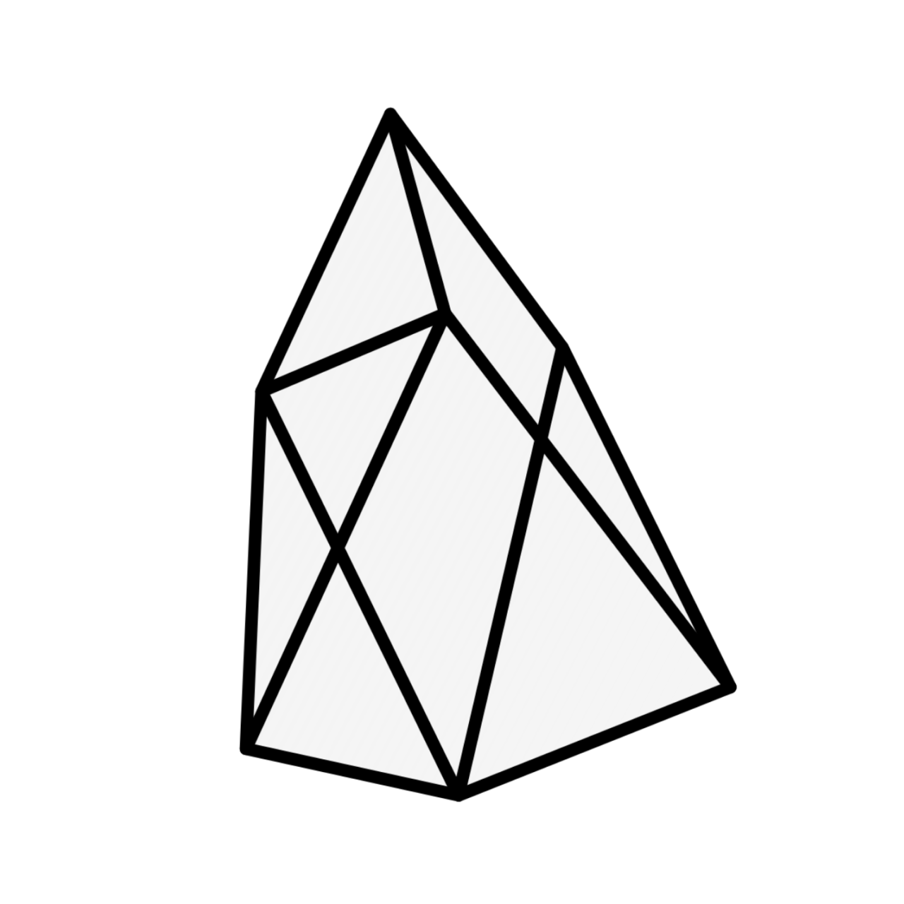

# CalQ

### A Mathematical Computing Environment for Android

Probability, linear algebra, graphing, and symbolic mathematics in one application.

**Light · Dark · Auto Themes**

---

## Features

- **Probability:** Probability distributions and interactive plots.
- **Matrix Calculator:** Numerical and symbolic matrix computations.
- **Graphing Calculator:** Interactive graphing and symbolic calculations.
- **Computer Algebra System (CAS):** Symbolic mathematics across multiple disciplines.
- **Shared Symbolic Workspace:** Reuse variables and expressions across calculation containers.
- **Mathematical Rendering:** Formatted mathematical expressions using KaTeX.
- **Customizable Interface:** Light, dark, and automatic themes.

---

## 1. Probability

 **Probability Calculator**

Explore probability distributions and visualize their behavior using interactive plots.

**Plot Features**
- Zoom in and out using `+` and `−`.
- Maximize and minimize plots.

<strong>Supported Distributions</strong>

**Discrete Distributions**
- Discrete Uniform
- Bernoulli
- Binomial
- Hypergeometric
- Geometric
- Negative Binomial
- Poisson

**Continuous Distributions**
- Normal
- Gamma
- Exponential

---

## 2. Matrix Calculator

 **Matrix Calculator**

Perform numerical and symbolic matrix computations.

**Features**
- Flexible matrix dimensions with configurable rows and columns.
- Unlimited matrix containers.
- Symbolic calculations using variables and algebraic expressions.
- Support for common and advanced linear algebra operations.

<strong>Supported Operations</strong>

- **Arithmetic:** Addition, subtraction, multiplication, and scalar multiplication.
- **Transformations:** Transpose and matrix powers.
- **Matrix Analysis:** Determinants, inverses, traces, and ranks.
- **Row Reduction:** Row echelon form (REF) and reduced row echelon form (RREF).
- **Advanced Linear Algebra:** Eigenvalues, eigenvectors, cofactors, and adjugates.
- **Special Matrices:** Identity matrices and related operations.

Example commands: `det(A)`, `inv(A)`, `rank(A)`, `rref(A)`, `eigenvalues(A)`, etc.

---

## 3. Graphing Calculator

 **Graphing Calculator**

Plot functions and explore mathematical behavior through interactive graphs.

**Features**
- Interactive plots with zooming, maximizing, and minimizing.
- Symbolic calculations.
- Unlimited calculation containers.
- Four specialized keypad layouts.

<strong>Keypad Layouts</strong>

- **Main:** Common mathematical operations.
- **Scientific:** Advanced mathematical functions.
- **Greek:** Greek letters and mathematical symbols.
- **Alphabet:** Variables and alphabetic input.

<strong>Supported Command Categories</strong>

- **Algebra:** Simplification, expansion, and factorization.
- **Calculus:** Derivatives, definite integrals, and limits.
- **Combinatorics:** Permutations, combinations, and factorials.
- **Number Theory:** Greatest common divisor and least common multiple.
- **Linear Algebra:** Matrix operations, determinants, inverses, and vector operations.
- **Statistics:** Mean, median, summation, and products.
- **Functions:** Absolute value, floor, ceiling, and remainder.
- **Advanced Graphing:** Piecewise functions, parametric curves, and polar curves.

Example commands: `simplify(x)`, `diff(f,x)`, `nCr(n,r)`, `mean(A)`, `parametric(...)`, etc.

---

## 4. Computer Algebra System (CAS)

 **Computer Algebra System**

Perform symbolic mathematical computations across multiple disciplines.

<strong>Supported Mathematical Categories</strong>

| Category | Capabilities |
|---|---|
| **Algebra** | Simplification, factorization, expansion, collection of terms, partial fractions, GCD, LCM, and completing the square |
| **Equations** | Equation solving and systems of equations |
| **Calculus** | Differentiation, integration, limits, summation, products, and Laplace transforms |
| **Linear Algebra** | Matrix construction, determinants, inverses, transposes, ranks, REF, RREF, nullspaces, and matrix transformations |
| **Trigonometry** | Trigonometric, inverse trigonometric, hyperbolic, and inverse hyperbolic functions |
| **Functions** | Square roots, logarithms, exponentials, absolute values, floor, and ceiling |
| **Complex Numbers** | Complex conjugates, real and imaginary parts |
| **Special Functions** | Sign and Heaviside functions |
| **Other Tools** | Chemical equation balancing |

<strong>Example CAS Commands</strong>

- **Algebra:** `simplify(...)`, `factor(...)`, `expand(...)`, etc.
- **Equations:** `solve(...)`, `solveeq(...)`, etc.
- **Calculus:** `integrate(...)`, `defint(...)`, `diff(...)`, `limit(...)`, etc.
- **Linear Algebra:** `det(A)`, `invert(A)`, `transpose(A)`, `nullspace(A)`, etc.
- **Trigonometry:** `sin(x)`, `cos(x)`, `tan(x)`, `asin(x)`, etc.
- **Functions:** `sqrt(x)`, `log(x)`, `ln(x)`, `exp(x)`, etc.
- **Complex Numbers:** `conjugate(x)`, `realpart(x)`, `imagpart(x)`, etc.
- **Chemical Equations:** `balance(...)`

---

## Shared Symbolic Workspace

CalQ connects calculation containers through a shared symbolic workspace, allowing calculations to build on previously defined variables and expressions.

- **Cross-container variables:** Reuse variables and results across different containers.
- **Expression reuse:** Reference existing expressions without repeatedly entering them.
- **Symbolic manipulation:** Store complex expressions in variables and reuse them in subsequent calculations.
- **Organized workflows:** Separate related calculations while retaining access to shared definitions.

This reduces repetitive input and makes complex mathematical workflows easier to manage.

---

## Technology and Libraries

CalQ uses mathematical libraries and rendering tools to support symbolic computation and the display of mathematical expressions.

- **[KaTeX](https://katex.org/):** Renders mathematical notation in a readable, typeset format.
- **[Nerdamer](https://nerdamer.com/):** Provides symbolic algebra capabilities, including manipulation and evaluation of mathematical expressions.

Additional libraries and technologies may be used throughout the application.

---

## Settings

Customize the application's appearance and preferences.

- Light theme
- Dark theme
- Automatic theme
- Application and interface settings

---

## Project Information

**CalQ** combines probability, matrix computation, interactive graphing, and symbolic mathematics in an Android-oriented application.

It provides a unified mathematical workspace for students and other users working with mathematical problems.

## License

Add your project's license information here.
